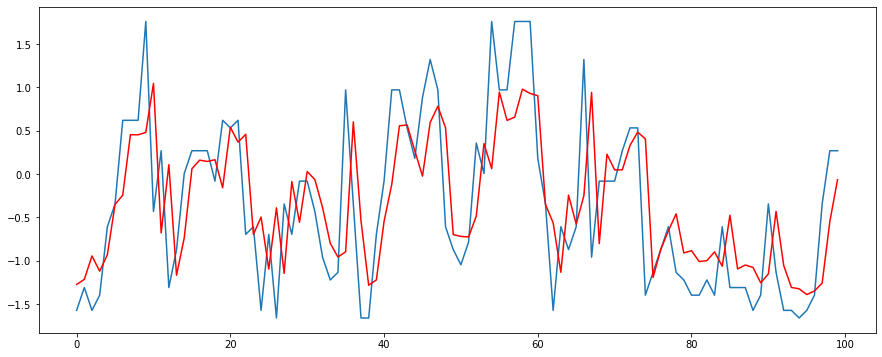
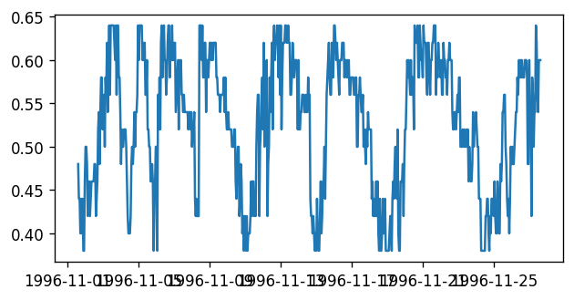
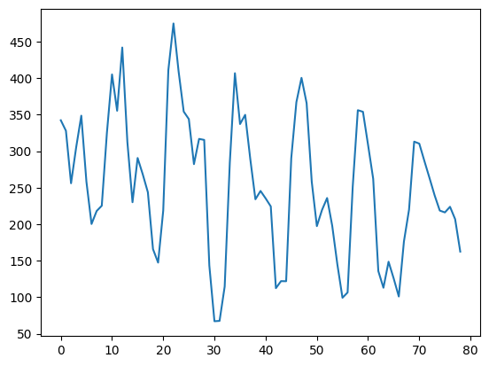
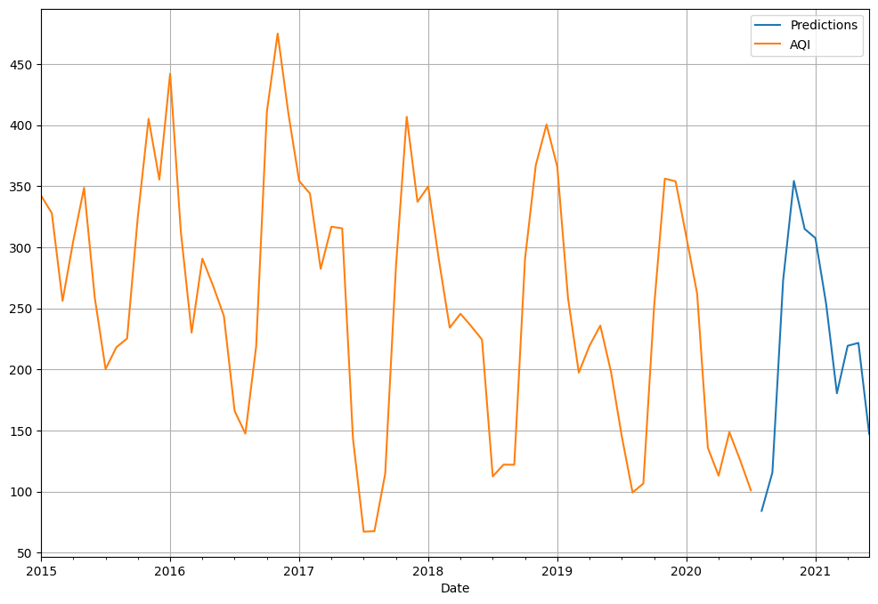

# Forecasting Analysis Using ARIMA and LSTM Models

Author: Tayyaba

## 1. Introduction

This project develops an intelligent environmental monitoring and forecasting system that integrates IoT sensing with machine learning-based time-series analysis. It focuses on monitoring weather parameters and forecasting future values, with specific emphasis on temperature and air quality index (AQI).

The work compares two forecasting approaches:

- LSTM, a deep learning model effective for sequential and nonlinear patterns.
- ARIMA, a statistical model widely used for time-series forecasting.

The project is designed to evaluate the practical usefulness of predictive analytics in environmental monitoring and decision-making.

## 2. Problem Statement

Accurate environmental forecasting is essential for agriculture, city planning, public health, and climate-related risk management. Conventional monitoring systems mainly report current conditions, but they do not predict future changes. This project addresses that gap by combining sensor-based data collection with forecasting models that can estimate future environmental conditions.

## 3. Objectives

- Collect environmental data using IoT-based sensors.
- Prepare the dataset for forecasting analysis.
- Apply ARIMA and LSTM models to predict environmental trends.
- Compare the accuracy and suitability of each model.
- Present the outcomes in a professional and technically sound format.

## 4. System Design

The prototype is built around an ESP8266/NodeMCU-based sensing architecture. It uses environmental sensors such as DHT11 and BMP180 to monitor temperature, humidity, and pressure.

### Block Diagram

The system follows a practical data pipeline:

1. Sensor data acquisition
2. Microcontroller processing
3. Cloud-based storage and monitoring
4. Data preprocessing
5. Forecasting and visualization

## 5. Data Collection and Preparation

The project uses sensor and historical data to build a robust training set. Data preprocessing includes:

- removing incomplete values
- filtering unrealistic measurements
- standardizing timestamps
- organizing the values into a time-series sequence

This step is essential to improve the quality of the forecasting models.

## 6. Forecasting Methodology

### 6.1 LSTM Model

LSTM is suitable for recognizing patterns over time and retaining long-term dependencies. It is especially effective when future values depend on historical fluctuations and nonlinear behavior.

### 6.2 ARIMA Model

ARIMA is a classical forecasting method that models current values based on previous observations, differencing, and moving average effects. It serves as an important benchmark against which the LSTM model is compared.

## 7. Temperature Forecasting Results

The forecast demonstrates that the model effectively follows the observed temperature pattern. This confirms the ability of time-series forecasting to capture recurring behavior and trend movement in environmental data.

## 8. AQI Forecasting Results

### LSTM AQI Forecast

### SARIMAX AQI Forecast

These results compare the recurrent forecasting approach with a statistical approach for AQI prediction. The visual analysis shows that both techniques produce meaningful forecasts, while the learning-based method is more capable of handling nonlinear patterns.

## 9. Discussion

The project demonstrates the value of combining hardware systems with prediction models. LSTM performs strongly in complex temporal forecasting, while ARIMA remains useful as a baseline and for simpler structured data patterns.

This integrated approach is relevant to:

- weather prediction
- AQI monitoring
- smart agriculture
- urban environmental management

## 10. Conclusion

This project successfully demonstrates an end-to-end forecasting workflow for environmental applications. It shows that by combining IoT sensing with machine learning, it is possible to move from raw monitoring data to meaningful predictive insights. The comparative results confirm that LSTM provides stronger forecasting performance for nonlinear sequences, while ARIMA remains a valuable benchmark.

## Author

Tayyaba

---
