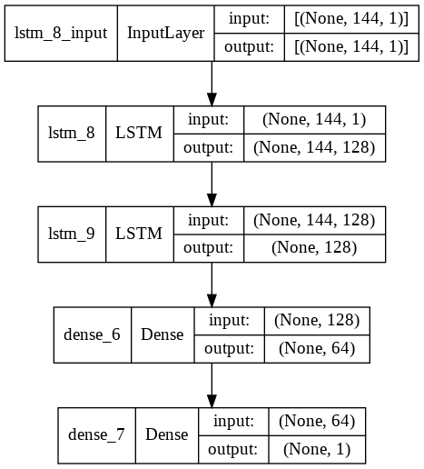
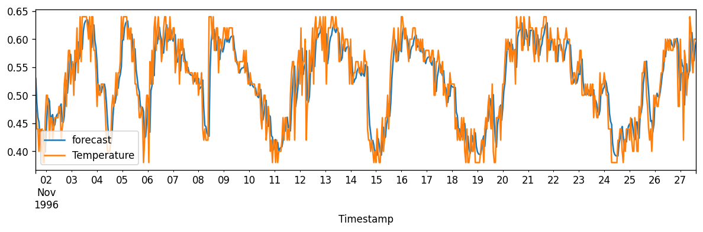

# Forecasting Analysis Project

Author: Tayyaba

## Project Overview

This project focuses on designing and implementing an intelligent weather and environmental forecasting system using IoT-based sensing and time-series prediction models. The aim is to move beyond basic monitoring and provide predictive insight into future environmental conditions.

The system considers several key variables:

- Temperature
- Humidity
- Pressure
- Air Quality Index (AQI)

The project is structured around two main components:

1. Hardware-based environmental sensing
2. Predictive analysis using ARIMA and LSTM models

## Significance of the Work

Environmental monitoring is critical for safety, public health, agriculture, and resource management. By combining sensor data with predictive analytics, this project demonstrates how monitoring systems can evolve from passive observation to active forecasting.

This gives the project both academic value and practical relevance in smart-city and sustainability applications.

## Hardware Development

The prototype uses NodeMCU and sensors such as DHT11 and BMP180 to collect environmental measurements. These devices are selected for their low cost, ease of deployment, and suitability for prototype-level monitoring systems.

### Hardware Block Diagram

The design reflects a realistic IoT data pipeline in which raw physical measurements are converted into digital observations for analysis.

## Software Development

The collected data is cleaned, processed, and structured into a time-series format. The project then compares two widely used forecasting approaches:

### LSTM Approach

LSTM is used because it is highly effective in modelling sequential and time-dependent data. It can capture long-term dependencies and nonlinear patterns, which are common in weather and air-quality datasets.

### ARIMA Approach

ARIMA acts as a traditional forecasting benchmark. It provides a strong statistical comparison point and helps assess the effectiveness of the deep learning method in relation to classical time-series modeling.

## Results and Discussion

The results show that both models are capable of detecting meaningful patterns in historical data, but the LSTM model generally performs better when the time series contains nonlinear behaviour and longer-term dependencies.

### LSTM Temperature Forecast

The LSTM forecast closely follows the real temperature pattern and demonstrates strong sequence-learning capability.

### ARIMA Temperature Forecast

The ARIMA output also provides a meaningful forecast, but it has a more limited ability to capture complex nonlinear variations.

## Project Conclusion

This project successfully demonstrates an end-to-end workflow from sensor-based monitoring to predictive analysis. It validates the idea that combining IoT devices with forecasting models can provide useful insight into environmental trends and future behavior.

The project lays a solid foundation for future enhancement in areas such as:

- improved predictive accuracy
- real-time dashboards
- broader parameter coverage
- deployment in smarter environmental monitoring systems

## Author

Tayyaba

---
